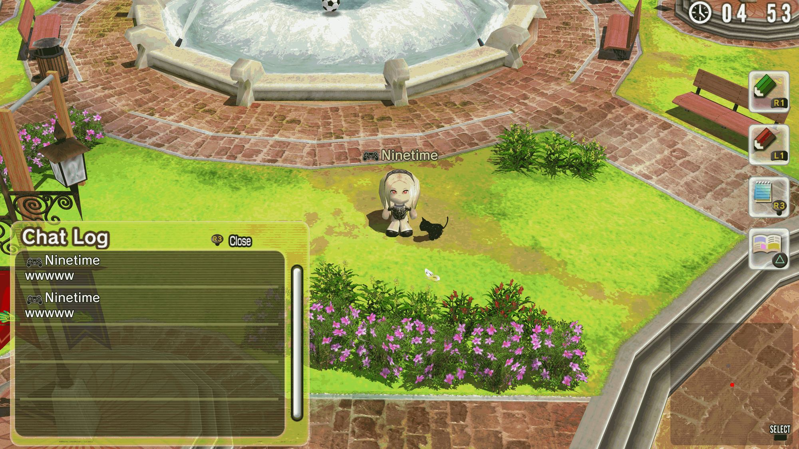
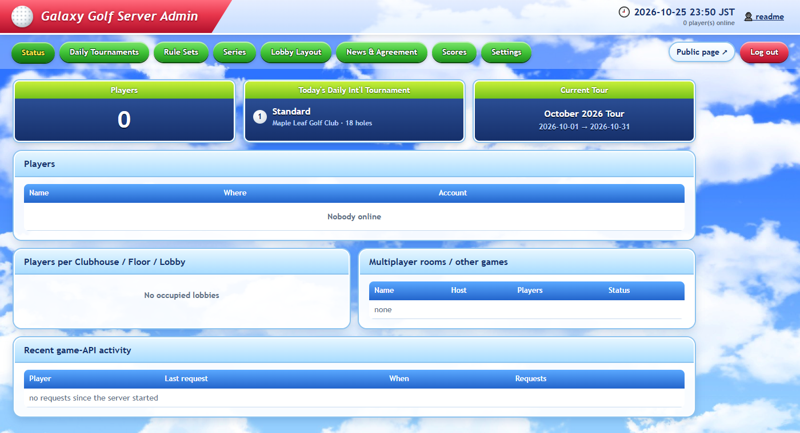

# Gravity Golf: a Hot Shots Golf: World Invitational revival server

Gravity Golf brings back the online modes of **Hot Shots Golf: World Invitational**
(Everybody's Golf 6, PS3, **NPUA80864**). Sony shut down the official servers years ago, and no
public replacement existed. This project is a from-scratch replacement for those servers. You
play through the [RPCS3](https://rpcs3.net) emulator.



*In a lobby on the revival server, running in RPCS3, with the Chat Log open.*



*The server admin page (Status tab) after logging in.*

## What works

- **Going online:** bootstrap (`ss.info`), EULA, login, server time and the news / Information
  screen.
- **Daily International Tournament:**
  - a new board every day (course, holes, tee and rules are set on the admin page)
  - score upload, with re-entry blocked once you've played
  - Tournament History and Results
- **Rankings:**
  - tour standings (Player Ranking) and the Prize King / Shot Point Ranking
  - per-board rankings, including friends-only mode
  - the end-of-tour ceremony
- **Lobby:** clubhouses, floors and lobbies, walking around with your avatar, free and easy
  chat, room creation and player search.
- **Admin page:** news, EULA, tournament series, rule sets, the daily schedule, the lobby layout,
  results management, server status and logs, all behind a login.
- **Public status page:** players online per lobby, results and tour standings, and the
  upcoming schedule. It shows no online names or locations.

Known gap: the in-lobby **Friends List** softlocks. That is an RPCS3 bug (`sceNpFriendlist` never
calls its result handler), not a server bug. See
[Third-Party Changes](https://github.com/Ninetime/gravitygolf/wiki/Third-Party-Changes) §5.

## Requirements

- A legally obtained copy of the game (**NPUA80864**, updated to **v01.03**) installed in
  [RPCS3](https://rpcs3.net). Some of the server's data files are extracted from it.
- Python 3.10 or newer. The server itself only uses the standard library; [Pillow](https://pypi.org/project/pillow/) (`pip install pillow`) is optional and only used to extract the admin page images.
- The [.NET 10 SDK](https://dotnet.microsoft.com/download) and [git](https://git-scm.com/), to
  build the Medius servers.
- Windows. The `.bat` scripts and the supervisor assume it, but the Python and .NET parts are
  cross-platform.

With those in place, setup is a clone and one command:

```sh
git clone --recursive https://github.com/Ninetime/gravitygolf.git
cd gravitygolf/hsg6
python build.py --usrdir <path to NPUA80864/USRDIR>
start_background.bat
```

See **[Building](https://github.com/Ninetime/gravitygolf/wiki/Building)** for the full instructions, what the build does, and first-run
setup.

## Connecting with RPCS3

1. In RPCS3, open **Manage → Game Patches** and enable **Server patching** for *Everybody's Golf 6
   / Hot Shots Golf: World Invitational*. It comes from RPCS3's patch database; if it isn't
   listed, click **Download latest patches**. See [RPCS3 Patch](https://github.com/Ninetime/gravitygolf/wiki/RPCS3-Patch) for what it
   does and the current entry.
2. In the game's custom configuration, under Network → **IP swap list**, add
   `cmnap.scej-online.jp=<server IP>`. Use `127.0.0.1` if the server runs on the same PC.
3. Set Network to Connected and PSN to RPCN. Your RPCN name becomes your in-game name.

## Hosting for other players

To host for players on other machines:
- Set the public address in `server/config.py` (`HSG6_MEDIUS_HOST`), then re-run
  `make_ssinfo.py`.
- Set it in `muis/muis.json`, and as `PublicIpOverride` / `NATIp` in `medius/medius.json` and
  `dme/dme.json`.
- Forward the game ports.

[Operations](https://github.com/Ninetime/gravitygolf/wiki/Operations) §3 has the full list. It also covers which ports must **not** be
exposed, the admin page's security model, the data files to back up, and troubleshooting.

## Documentation

The [wiki](https://github.com/Ninetime/gravitygolf/wiki) has the rest:
- [Building](https://github.com/Ninetime/gravitygolf/wiki/Building)
- [RPCS3 Patch](https://github.com/Ninetime/gravitygolf/wiki/RPCS3-Patch)
- [Operations](https://github.com/Ninetime/gravitygolf/wiki/Operations)
- [Protocol](https://github.com/Ninetime/gravitygolf/wiki/Protocol), the reverse-engineered protocol
- [Third-Party Changes](https://github.com/Ninetime/gravitygolf/wiki/Third-Party-Changes)
- [How It Was Made](https://github.com/Ninetime/gravitygolf/wiki/How-It-Was-Made), including the AI assistance
- [Layout](https://github.com/Ninetime/gravitygolf/wiki/Layout)

## License

This project is released under the [MIT License](LICENSE). The Horizon-derived parts (the patch
and the Medius config files) stay under Horizon's own MIT notice; see Credits below.

## Credits

- Server, protocol research and documentation by **Ninetime**, with AI assistance from
  **Claude** (Anthropic).
- **Medius server:** [Horizon Private Server](https://github.com/Horizon-Private-Server/horizon-server)
  by Daniel Gerendasy and the Horizon contributors.
  - It's an open-source Medius server emulator, originally built to revive the online servers of
    *Ratchet: Deadlocked* (PS2).
  - All of the lobby, login, game-world and NAT servers here are Horizon. This project only adds
    the HSG6 fixes in `hsg6/docs/horizon-server.patch`.
  - Horizon is released under the MIT License. Its copyright and permission notice is reproduced
    in [`hsg6/docs/licenses/horizon-server-LICENSE.txt`](hsg6/docs/licenses/horizon-server-LICENSE.txt).
    That notice also covers the parts of the patch and the `medius/`, `muis/`, `dme/`, `nat/`
    config files that come from Horizon.
- The [RPCS3](https://rpcs3.net) and [RPCN](https://github.com/RipleyTom/rpcn) projects.

Hot Shots Golf / Everybody's Golf is a trademark of Sony Interactive Entertainment. This project
is not affiliated with or endorsed by Sony. It contains no game files: everything game-derived
is extracted from your own copy.
